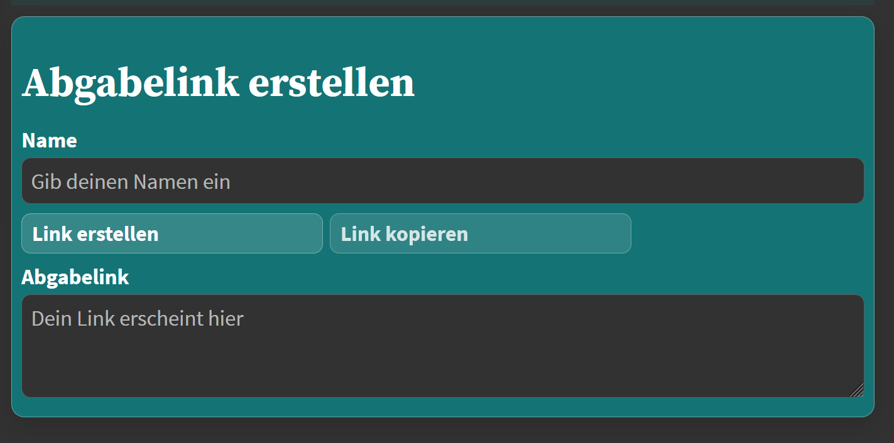
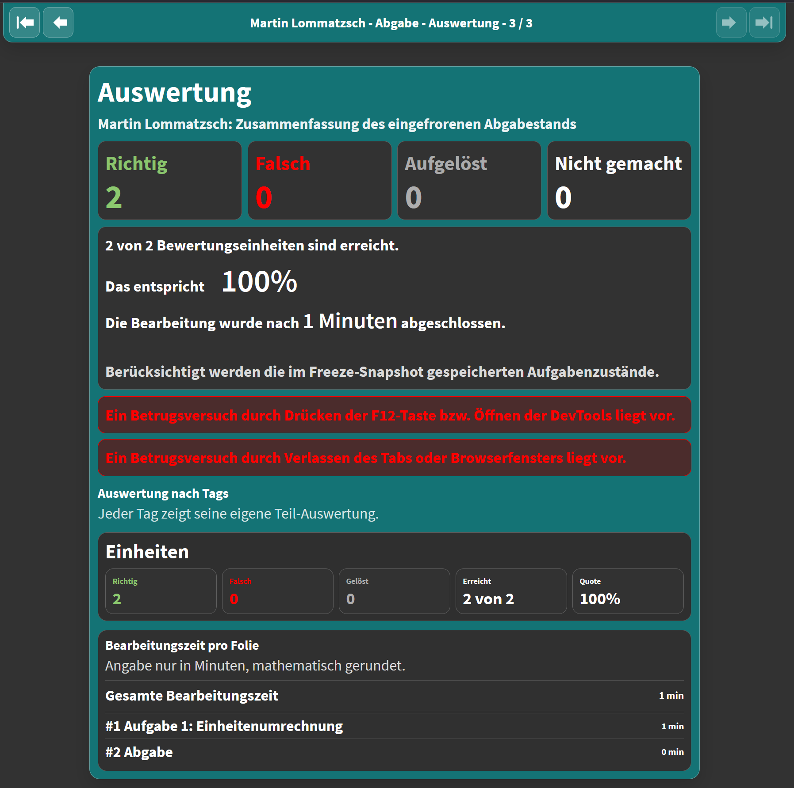

<!--
version: 0.1.0
language: de
narrator: Deutsch Female

mode: Presentation

import: https://raw.githubusercontent.com/MINT-the-GAP/lia-DynFlex/refs/heads/main/README.md
import: https://raw.githubusercontent.com/MINT-the-GAP/lia-timer/refs/heads/main/README.md
import: https://raw.githubusercontent.com/MINT-the-GAP/lia-board-mode/refs/heads/main/README.md
import: https://raw.githubusercontent.com/MINT-the-GAP/lia-marker/refs/heads/main/README.md
import: https://raw.githubusercontent.com/MINT-the-GAP/lia-annotation/refs/heads/main/README.md
import: https://raw.githubusercontent.com/MINT-the-GAP/lia-canvas-ocr/refs/heads/main/README.md
import: https://raw.githubusercontent.com/MINT-the-GAP/lia-orthography/refs/heads/main/README.md
import: https://raw.githubusercontent.com/MINT-the-GAP/lia-Mathe/refs/heads/main/README.md
import: https://raw.githubusercontent.com/MINT-the-GAP/lia-kachel/refs/heads/main/README.md
import: https://raw.githubusercontent.com/MINT-the-GAP/lia-navigation/refs/heads/main/README.md
import: https://raw.githubusercontent.com/MINT-the-GAP/lia-mathpath/refs/heads/master/README.md

import: https://raw.githubusercontent.com/MINT-the-GAP/lia-llm/refs/heads/main/README.md

import: https://raw.githubusercontent.com/liaTemplates/algebrite/master/README.md
import: https://raw.githubusercontent.com/liaTemplates/JSXGraph/main/README.md

import: https://raw.githubusercontent.com/MINT-the-GAP/lia-resetter/main/README.md

import: https://raw.githubusercontent.com/MINT-the-GAP/lia-coordinate/refs/heads/main/README.md
import: https://raw.githubusercontent.com/MINT-the-GAP/lia-freeze-v2/main/README.md
import: https://raw.githubusercontent.com/MINT-the-GAP/lia-loot/main/README.md

import: https://raw.githubusercontent.com/MINT-the-GAP/lia-pentominos/main/README.md


import: https://raw.githubusercontent.com/liaTemplates/ABCjs/main/README.md

import: https://raw.githubusercontent.com/liaTemplates/Speech-Recognition-Quiz/refs/heads/main/README.md


tags: Erkundungskurs, Fortbildung, LiaScript, OER

comment:  Fortbildung 2026 — LiaScript in der Schule.
          Martin Lommatzsch (Geschwister-Scholl-Gymnasium Freiberg).

author: Martin Lommatzsch

-->

# Erkundungskurs für die LiaScript-Fortbildung


@Ressourcen(50, 50, 250)
@achievements
@Highscore(10000, 100, 250, 20, 500)


> [!NOTE]
> Willkommen im Erkundungskurs. Auf dieser Folie finden Sie eine kurze Übersicht über alle üblichen Bedienungsoptionen, die von mir für die Schülerinnen und Schüler auch bei dem Erstkontakt bereitgestellt werden. <p align="right">– Martin Lommatzsch</p>


---

---


---

---

---

---


> [!CAUTION]
> <h2> @Explain(Tutorial) </h2>


---

---

---

---


##  Einfache Quizarten


<section class="dynFlex">

<div class="flex-child">


**_Aufgabe 1:_** **Kreuze an**, wie viel $\dfrac{1}{10}$ von $2\,$m$^2$ sind.

- [( )] $0,02\,$m$^2$
- [( )] $0,1\,$m$^2$
- [( )] $1,9\,$m$^2$
- [( )] $2\,$dm$^2$
- [(X)] $20\,$dm$^2$

</div>

<div class="flex-child">


**_Aufgabe 2:_** **Kreuze** den Wert des Terms $6 : \dfrac{3}{2} - \dfrac{1}{2}$ **an**.

<!-- horizontal-quiz  data-solution-timer="15s" 
data-solution-timer-start="oncheck" 
data-solution-timer-badge="on" -->
- [( )] $-\dfrac{1}{4}$
- [( )] $\dfrac{1}{2}$
- [(X)] $\dfrac{7}{2}$
- [( )] $6$
- [( )] $\dfrac{17}{2}$


</div>

<div class="flex-child">

**_Aufgabe 3:_** **Kreuze an**, welche Terme äquivalent zu $a^{\frac{2}{3}}$ sind.

- [[ ]] $\sqrt[2]{a^3}$
- [[X]] $\sqrt[3]{a^2}$
- [[ ]] $\frac{2}{3}a$
- [[ ]] $\frac{3}{2}a$
- [[X]] $\sqrt[6]{a}^4$

</div>


</section>


---

---

<section class="dynFlex">

<div class="flex-child">

**_Aufgabe 4:_** **Entscheide**, ob es sich bei dem Term um einen Vektor, einen Skalar oder einen nicht definierten Ausdruck handelt.


<!-- data-solution-timer="5s" 
data-solution-timer-start="oncheck" 
data-solution-timer-badge="off" 
data-solution-button="5" 
data-hint-button="3"  -->
- [[Vektor]       (Skalar)    [nicht definiert]]
- [    [X]           [ ]             [ ]     ]  $ \vec{r} \cdot \left( \vec{n} \circ \vec{s}\right) $
- [    ( )           (X)             ( )     ]  $ \lambda{\vec{d}}^{\,2} \cdot \left|\vec{k}\right| $
- [    [ ]           [ ]             [X]     ]  $ \left|\vec{a}\right| \times s \cdot \vec{b} $
- [    ( )           (X)             ( )     ]  $ \left( \vec{z} \times \lambda\vec{x}\right) \circ \vec{c} $
- [    [ ]           [ ]             [X]     ]  $ \dfrac{\vec{u}-\mu \vec{v}}{\vec{u}+\vec{v}} $

</div>

<div class="flex-child">

**_Aufgabe 5:_**  **Wähle** die Rechenoperatoren **aus**, sodass die Gleichung eine wahre Aussage widerspiegelt.


<!-- data-solution-timer="5s" 
data-solution-timer-start="oncheck" 
data-solution-timer-badge="off" 
data-solution-button="5" 
data-hint-button="3"  -->
$8$ [[$+$|($-$)|$\cdot$|$:$]] $2$ [[$+$|$-$|($\cdot$)|$:$]] $3 = 2$

</div>

<div class="flex-child">


**_Aufgabe 6:_**  **Sortiere** die Kacheln nach Größe und **ordne** sie der passenden Größe zu.


<!-- data-solution-timer="5s" 
data-solution-timer-start="oncheck" 
data-solution-timer-badge="off" 
data-solution-button="5" 
data-hint-button="3" 
data-randomize="true"  -->
Zeit:  [->[($250$ min)]]$>$ [->[($4,1$ h)]] $>$ [->[($14640$ s)]]  $>$ [->[($120^2$ s)]]  \

</div>


</section>


---

---


##  Erweiterte Quizarten


<section class="dynFlex">

<div class="flex-child">

**_Aufgabe 1:_**  **Berechne** den Wert des Terms.


<!-- data-solution-timer="15s" 
data-solution-timer-start="oncheck" 
data-solution-timer-badge="on"   -->
$16428 : 6=$ [[ 2738 ]] @canvas
[[?]] @Explain
****************
$$
\begin{align*}
 16428:6 &= 2738 \\
 \underline{-\textcolor{blue}{12}}\hspace{0.5em}\hspace{0.5em}\hspace{0.85em}\hspace{0.5em} \hspace{0.5em}& \\
 44\hspace{0.5em}\hspace{0.85em}\hspace{0.5em} \hspace{0.5em} & \\
 \underline{-\textcolor{green}{42}}\hspace{0.85em}\hspace{0.5em}\hspace{0.5em} \hspace{0.5em}  & \\
 22\hspace{0.85em}\hspace{0.5em} \hspace{0.5em} & \\
 \underline{-\textcolor{orange}{18}}\hspace{0.85em}\hspace{0.5em} \hspace{0.5em} & \\
 48\hspace{0.85em}\hspace{0.5em}   & \\
 \underline{-\textcolor{red}{48}}\hspace{0.85em}\hspace{0.5em} & \\
 0\hspace{0.85em}\hspace{0.5em} & \\
\end{align*}
$$
****************

@ADetails(1=BE; Division, Grundrechenarten)

</div>

<div class="flex-child">


**_Aufgabe 2:_** **Gib** den ungefähren Wert der abgebildeten Objekte **an**. 

> Durch ein Makro können diese Aufgaben neu gestartet werden.


<!-- data-solution-timer="5s" 
data-solution-timer-start="oncheck" 
data-solution-timer-badge="off" 
data-solution-button="5" 
data-hint-button="3"  -->
[[ 200  ]] @canvas Kandiszuckerstückchen
@Algebrite.check_margin(175,250)

@resetter


</div>

<div class="flex-child">

**_Aufgabe 3:_** **Gib** den Term $(x-2)^2-1$ in einer beliebigen Form **an**.

[[    (x-2)^2-1    ]] @canvas
@Algebrite.check(`x ^ 2 - 4 * x + 3`)

@resetter

</div>


</section>


##  Aufwendigeres


<section class="dynFlex">

<div class="flex-child">

**_Aufgabe 1:_** **Stelle** die passende Teilung der Fläche **ein** und **markiere** den passenden Anteil, sodass der Bruch dargestellt wird.

$\dfrac{7}{8}$

@circleQuiz(7/8, <!-- data-solution-timer="5s" data-solution-timer-start="oncheck" data-solution-timer-badge="off" data-solution-button="5" 
data-hint-button="3" -->)

</div>

<div class="flex-child">

**_Aufgabe 2:_** **Stelle** die passende Teilung der Fläche **ein** und **markiere** den passenden Anteil, sodass der Bruch dargestellt wird.

$\dfrac{7}{10}$

@rectQuiz(7/10, <!-- data-solution-timer="5s" data-solution-timer-start="oncheck" data-solution-timer-badge="off" data-solution-button="5" 
data-hint-button="3" -->)

</div>

<div class="flex-child">


**_Aufgabe 3:_** **Ziehe** den Punkt $A$ auf die Koordinaten $(2 | 3)$.


@CoordinateSystem(`xmin=-5;xmax=5;ymin=-4;ymax=4;width=800;id=ex_point_ez`)

@AxisLabel(`id=ex_point_ez;xlabel=$x$;ylabel=$y$`)

@CreatePoint(`ex_point_ez;A;2;3`,` `)

</div>

</section>

---

---


<section class="dynFlex">

<div class="flex-child">

**_Aufgabe 4:_** **Miss** die markierten Strecken mit dem Geodreieck und **gib** die Länge in LE **an**.

@CoordinateSystem(`xmin=-1;xmax=12;ymin=-4;ymax=4;width=600;id=GL0012a;0;0;1`)
@SetSquare(`GL0012a`)

@Point(`GL0012a;A;1;0;#ff00ff;1;fix`)
@Point(`GL0012a;B;5;0;#ff00ff;1;fix`)
@Strecke(`GL0012a;[A;B];#ff00ff;s=0`)

<!-- data-solution-timer="5s"
data-solution-timer-start="oncheck"
data-solution-timer-badge="off"
data-solution-button="5"
data-hint-button="3"  -->
$|\overline{AB}| =$ [[ 4 ]] LE
@Algebrite.check(4)
[[?]] @Explain

@ADetails(1=BE; Strecke, Messen, Einheiten)

</div>

<div class="flex-child">

**_Aufgabe 5:_** **Miss** die markierten Winkel mit dem Geodreieck und **gib** das Winkelmaß in Grad **an**.


@CoordinateSystem(`xmin=-3.4;xmax=3.8;ymin=-2.8;ymax=3.8;width=600;id=WA0015a;0;0;1`)
@DGS(`WA0015a;tools=[0];restrictions=[100;300;400]`)

@Punkt(`WA0015a;Z;0;0;#e63946;0;fix`)
@Punkt(`WA0015a;A;3;0;#e63946;0;fix`)
@Punkt(`WA0015a;B;2.26;1.97;#e63946;0;fix`)

@Strecke(`WA0015a;[Z;A];#ff00ff;`)
@Strecke(`WA0015a;[Z;B];#ff00ff;`)
@Winkel(`WA0015a;\alpha;[A;Z;B];#00ffff;0.78;0`)

<!-- data-solution-timer="5s"
data-solution-timer-start="oncheck"
data-solution-timer-badge="off"
data-solution-button="5"
data-hint-button="3"  -->
$\alpha =$ [[ 41 ]]$^\circ$
@Algebrite.check2(41,0.5)

</div>

<div class="flex-child">

**Aufgabe 6:** Zeichne den Graphen zur Funktion $f(x) = 2x - 1$.

@CoordinateSystem(`xmin=-7;xmax=7;ymin=-5;ymax=5;width=800;id=FoBi26recon`)

@AxisLabel(`id=FoBi26recon;xlabel=$x$;ylabel=$y$`)

@Reconstruction(`FoBi26recon;2x-1;0.1`)


</div>

</section>


##  Komplexeres


<section class="dynFlex">

<div class="flex-child">

**_Aufgabe 1:_** **Konstruiere** das Dreieck $ABC$ mit den Winkeln $\alpha=40^\circ$ und $\beta=80^\circ$ sowie der Seitenlänge $a=4\,\mathrm{cm}$.

@Koordinatensystem(`xmin=-1;xmax=9;ymin=-1;ymax=8;width=600;id=D6501`)
@AchsenBeschriftung(`id=D6501;xlabel=$x$;ylabel=$y$`)
@DGS(`D6501;tools=[200;510;920]`)

@KonstruktionQuiz(`D6501;3;fest;W40,W80,S4;streckentoleranz=0.05;winkeltoleranz=1`,`<!-- data-solution-button="5" -->`)

</div>

<div class="flex-child">

**_Aufgabe 2:_** **Konstruiere** ein Rechteck mit $A=20\,FE$ und $u=18\,LE$.

@CoordinateSystem(`xmin=-1;xmax=9;ymin=-1;ymax=9;width=500;id=RA0047a;1;1;1`)
@AxisLabel(`id=RA0047a;xlabel=$x$;ylabel=$y$`)
@DGS(`RA0047a;tools=[200;510;920]`)

@GeometrieQuiz(`RA0047a;4;Konstruktion(offen;W90,W90,W90,W90;winkeltoleranz=1);Flaeche(20;0.05);Umfang(18;0.05)`,`<!-- data-solution-timer="5s" data-solution-timer-start="oncheck" data-solution-timer-badge="off" data-solution-button="5" data-hint-button="3" -->`)

</div>

<div class="flex-child">


**_Aufgabe 3:_** **Decke** mit dem gegebenen Polyomino eine Summe von 140 **ab**.

@PentominoQuiz(140,`name=FoBi-I5;type=I5;numbers=[1,2,3,4,5]`,`<!-- data-solution-button="off" -->`)

</div>

</section>

---

---


<section class="dynFlex">


<div class="flex-child">


**_Aufgabe 4:_** **Decke** mit dem gegebenen Polyomino eine Summe von -35 **ab**.

@PentominoQuizN(-35,`name=FoBi-I2;type=I2;numbers=[2,3]`,`<!-- data-solution-button="off" -->`)

</div>


<div class="flex-child">

**_Aufgabe 5:_** **Decke** mit einem oder mehreren der gegebenen Polyominos eine Summe von 108 **ab**.

@PentominoDockQuizAuswahl(108,`T4,L4,S4`,`<!-- data-solution-button="off" -->`)

</div>

<div class="flex-child">


**_Aufgabe 6:_** **Begründe** in zwei bis drei vollständigen Sätzen, warum die Summe zweier ungerader ganzer Zahlen immer gerade ist. Verwende eine allgemeine Begründung; einzelne Zahlenbeispiele reichen nicht aus.

<!-- data-solution-button="off" data-llm-textarea="5" -->
[[Antwort]]
[[?]] Schreibe jede ungerade Zahl als das Doppelte einer ganzen Zahl plus eins.
```text @LLMQuiz(0.66;solution=1;feedback=1;assessmentengine=quality;operator=begruenden;Rechtschreibung=1;Satzbau=1;maxthinkingtime=15s;maxthinkingtokens=medium,`Begründe in zwei bis drei vollständigen Sätzen, warum die Summe zweier ungerader ganzer Zahlen immer gerade ist. Verwende eine allgemeine Begründung; einzelne Zahlenbeispiele reichen nicht aus.`)
Zwei ungerade ganze Zahlen lassen sich als $2m+1$ und $2n+1$ mit ganzen Zahlen $m$ und $n$ schreiben. Ihre Summe ist $(2m+1)+(2n+1)=2(m+n+1)$. Da $m+n+1$ eine ganze Zahl ist, ist die Summe durch zwei teilbar und somit gerade.
<!-- lia-llm:alternative -->
Jede ungerade ganze Zahl ist eine gerade ganze Zahl plus eins. Bei der Addition zweier ungerader Zahlen erhält man deshalb die Summe zweier gerader Zahlen plus zwei. Diese Summe ist durch zwei teilbar und daher gerade.
```

@resetter

</div>

</section>


##  Über den Tellerrand


<section class=dynFlex>

<div class=flex-child>

**_Aufgabe 1:_** **Markiere** @markedred(das Subjekt in Rot), @markedblue(das Prädikat in Blau) und @markedgreen(das Objekt in Grün). \

$\;$ \


<!-- data-solution-timer="120s" data-solution-timer-start="oncheck" data-solution-timer-badge="off" -->
<div class=markerquiz>
@markred(Die neugierige Schülerin) @markblue(entdeckt) @markgreen(eine alte Schachtel).

@TextmarkerQuiz
</div>

</div>

<div class=flex-child>

**_Aufgabe 2:_** **Hör** dir den Satz gut **an** und **schreibe** ihn korrekt nieder.


<!-- data-solution-timer="600s" data-solution-timer-start="oncheck" data-solution-timer-badge="off" -->
@diktat(`Der Hund rennt heute schnell durch den Garten.`)


</div>

<div class=flex-child>

**_Aufgabe 3:_** **Korrigiere** alle Rechtschreibfehler.


@orthography(`<!-- data-solution-timer="90s" data-solution-timer-start="oncheck" data-solution-timer-badge="off" -->`,`Im Sumer spielen wir oft auf dem Schulhof Fangen.`,`Im Sommer spielen wir oft auf dem Schulhof Fangen.`)

</div>

</section>


---

---


<section class=dynFlex>

<div class=flex-child>

**_Aufgabe 4:_** Say 'Good morning' in English.

<!-- data-solution-button="off" -->
[[!]]
@SpeechRecognition(en-US,`Good morning`)

</div>

<div class=flex-child>


**_Aufgabe 5:_** Klicke auf die beiden Noten und gib die Kadenz an.

``` abc  @ABCJS.render
X: 1
L: 1/2
K: C
[|\
G  C:|
```

Kadenz: [[  Quinte  ]]


</div>

<div class=flex-child>

**_Aufgabe 6:_** Korrigiere den Fehler im Code und lass dir die Anzahl der Buchstaben der Nachricht ausgeben. Drück dazu mal unten links dieses `</>`-Symbol.

``` js
var message = "Dies ist die Nachricht"
console.log(message)
message.length
```
<script>@input </script>


</div>

</section>


---

---

> Alle dargestellten Quizze sind miteinander kombinierbar.


<section class=dynFlex>

<div class=flex-child>

**_Aufgabe 7:_** **Ordne** jedem Baum seine Blätter **zu**, indem du die Kacheln in das passende Feld ziehst.


<!-- data-randomize="true" data-show-partial-solution="true" data-solution-timer="300s" data-solution-timer-start="oncheck" data-solution-timer-badge="off" -->
<div>Ahorn: [->[()|]]  $\;\qquad\,$
Birke: [->[()]] $\;\qquad\;\;\;$
Eiche: [->[()]] $\;\quad\;$ </div> 

</div>

<div class=flex-child>


**_Aufgabe 8:_** 
**Ordne** die Tonspuren der Vogelart **zu**.

<!-- data-show-partial-solution="true" data-randomize="true"  data-solution-timer="600s" data-solution-timer-start="oncheck" data-solution-timer-badge="off" -->
<div>Blaumeise: [->[(?[](https://upload.wikimedia.org/wikipedia/commons/4/42/Cyanistes_caeruleus_-_Eurasian_Blue_Tit_XC131316.ogg))]]   $\;\qquad\,$
Amsel: [->[(?[](https://upload.wikimedia.org/wikipedia/commons/7/7c/Turdus_merula_2.ogg))|?[](https://upload.wikimedia.org/wikipedia/commons/b/b6/Pica_pica.ogg)]]</div>


<small><small><small><small><small>

Quellen: \

- „Cyanistes caeruleus - Eurasian Blue Tit XC131316.ogg“ von Dan Stowell, Quelle: Wikimedia Commons / Xeno-Canto, Lizenz: CC BY-SA 3.0 \
- „Turdus merula 2.ogg“ von Oona Räisänen (Mysid), Quelle: Wikimedia Commons, gemeinfrei / Public Domain \
- „Pica pica.ogg“ von Oona Räisänen (Mysid), Quelle: Wikimedia Commons, gemeinfrei / Public Domain

</small></small></small></small></small>


</div>

</section>


---

---

> Andere Inhalte können auch eingebettet werden.


<section class=dynFlex>

<div class=flex-child>

**_Beispiel 1:_** Auch Experimente an Robotern aus der Ferne mit den Remote-Laboren durch `edrys` sind möglich. (Hier durch ein Video vorgestellt und eingebunden.)

!?[](https://www.youtube.com/watch?v=6ZjGHorc2ds)

</div>

<div class=flex-child>

**_Beispiel 2:_** PhET-Simulationen sind einfach einzubinden.

??[](https://phet.colorado.edu/sims/html/sound-waves/latest/sound-waves_all.html)


</div>

<div class=flex-child>

**_Beispiel 3:_** Eigene Inhalte von anderen Servern.

??[](https://wochenaufgaben.gsg-freiberg.de/viervieren/index.html)


</div>

</section>


---

---

> Auch offene Aufgaben mit Operatoren wie „Beschreibe“, „Erkläre“ oder „Begründe“ sind möglich. Ein mathematisches LLM-Quiz mit Qualitäts- und Sprachprüfung findest du unter [Komplexeres, Aufgabe 6](#5).


##  Gamifizierungsoptionen


Die Kisten können überall versteckt sein.

**_Aufgabe 1:_** Durchsuchen Sie bitte alle Menüs, bis Sie ein Achievement erhalten, das bestätigt, dass Sie alle Diamanttruhen gefunden haben. (Hinweis: Die Truhen sind nur zu sehen, solange Sie sich auf dieser Folie befinden.)


@Diamanttruhe(info; anker)
@Diamanttruhe(mode; anker)
@Diamanttruhe(translator; anker)


---

---


Mit der Lupe @Lupe können Sie alle unsichtbaren Inhalte sichtbar machen, wie diesen: @Schatztruhe(zauberstaub) oder diesen: @Schatztruhe(unsichtbar). Mit der Schaufel @Schaufel können Sie etwas aus der Erde ausgraben und mit der Gießkanne @Giesskanne die Pflanzen zum Blühen bringen und anschließend pflücken.

@Erdhaufen
@Schatztruhe
@EndeErdhaufen

@Pflanze
@Schatztruhe
@EndePflanze


**_Aufgabe 2:_** Suchen Sie alle unsichtbaren Schatztruhen, bis Sie ein Achievement für die Schatztruhen bekommen.


---

---

Mit Schlüsseln kann man ganze Bereiche abschließen und den Schlüssel dabei auch noch verstecken.

**_Aufgabe 3:_** Graben Sie den Schlüssel aus und schalten Sie den unteren Bereich frei. Lesen Sie anschließend die unsichtbare Anweisung und führen Sie diese aus.

@Erdhaufen(zauberstaub)
@Pflanze(zauberstaub)
@Schluessel(gruen; anker)
@EndePflanze
@EndeErdhaufen

<section class=dynFlex>

<div class=flex-child>

@Unsichtbar(`Es gibt auch geheime Folien. Geben Sie in der Navigationssuche "Geheimnis" ein und klicken Sie auf diese nun erscheinende Folie.`)

</div>

</section>

@Schloss(dynflex, gruen)


## Geheimnis


@Geheimfolie


Auch gibt es Puzzleteile 
@Puzzleteil(blau; 1) 
@Puzzleteil(blau; 2) 
@Puzzleteil(blau; 3) 
@Puzzleteil(blau; 4) 
@Puzzleteil(blau; 5) 
@Puzzleteil(blau; 6)
, die Sie einsammeln können. Anschließend können Sie die Puzzleteile in das Tor einfügen, um dieses zu öffnen.

@Schloss(Seitenwechsel; blue; anker)
@Schloss(TOC; blue; anker)

**_Aufgabe 4:_** Öffnen Sie das Tor. Der folgende Term gibt Aufschluss darüber, wie die Puzzleteile angeordnet werden müssen. 

$$
\begin{align*}
\left(\begin{array}{c} 3 \\ 1 \\ 6  \end{array}\right) \circ \left(\begin{array}{c} 5 \\ 4 \\ 2  \end{array}\right)
\end{align*}
$$


@Puzzletor(blau; [[3;5];[1;4];[6;2]]; anker)


Mittels Portalen können Sie die Schülerinnen und Schüler auch auf bestimmte Folien lenken, wenn Sie `TOC` und `Seitenwechsel` sperren. Mit diesem Portal kommen Sie wieder zurück zur vorherigen Folie und dort erscheint ein Portal, um wieder hierher zurückzukehren.

@Portal(7)


##  Verbindlichkeit und Bewertbarkeit


Es ist möglich, den Schülerinnen und Schülern eine Bearbeitungszeit vorzugeben und dann den aktuellen Zustand einzufrieren und versendbar zu machen. Dies geschieht durch die Generierung einer URL, in der alle Bearbeitungsinformationen codiert sind.


Wenn Sie einen Freezelink erhalten, können Sie natürlich noch händisch in die Bewertung eingreifen und die Eingaben der Einsender einsehen.

<section class=dynFlex>

<div class=flex-child>



</div>

<div class=flex-child>



</div>

</section>


##  Propädeutik


**_Aufgabe 1:_** Skizzieren Sie mit der Annotationsmöglichkeit ein Koordinatensystem und platzieren Sie dieses auf diese Folie. Erkunden Sie das DGS.


